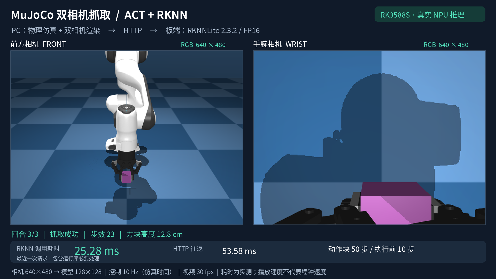

# RK3588S NPU跑ACT

将 **LeRobot ACT** 转换为 RKNN FP16，在 **RK3588S NPU** 上运行推理服务；PC 运行 MuJoCo 双相机仿真，通过 HTTP 请求动作，完成机械臂抓取闭环。

- **代码**：本仓库，只包含转换、推理服务、客户端与使用说明；LeRobot 通过外部依赖安装。
- **模型**：[allros/act-franka-rk3588s](https://huggingface.co/allros/act-franka-rk3588s)，包含原始 PyTorch 检查点、预处理统计量、RKNN FP16 与校验值。
- **演示**：[双相机抓取视频](docs/assets/demo.mp4)，前方/手腕相机、RKNN 调用耗时与 HTTP 往返耗时叠加显示。



## 运行方式

```text
PC：MuJoCo → 前方/手腕相机 + 机器人状态 → HTTP
                                               ↓
                                      RK3588S：RKNNLite / NPU
                                               ↓
PC：执行前 10 步动作 ← 返回 50 步动作块 ← 模型推理
```

默认使用 **PC 仿真 + 板端推理**。板端只需要 NumPy、RKNNLite 与运行库，不需要安装 LeRobot 或 PyTorch。

## 快速开始：RK3588S 板端

已测：Ubuntu 22.04 aarch64、Python 3.10.12、RKNNLite/librknnrt 2.3.2、RKNPU 驱动 0.9.8。板端需要已有的 Rockchip NPU 驱动和 `render`、`video` 设备组。

```bash
git clone https://github.com/llros007/rknn_lerobot.git
cd rknn_lerobot
# 安装 uv 后使用；也可以用 python3 -m venv + pip 完成同样操作
uv venv --python python3.10 .venv-board
uv pip install --python .venv-board/bin/python -r requirements-board.txt

mkdir -p vendor lib
# Python 3.10 / aarch64 对应的官方 RKNNLite 2.3.2 wheel
curl -fL -o vendor/rknn_lite.whl \
  https://github.com/airockchip/rknn-toolkit2/raw/v2.3.2/rknn-toolkit-lite2/packages/rknn_toolkit_lite2-2.3.2-cp310-cp310-manylinux_2_17_aarch64.manylinux2014_aarch64.whl
# wheel 文件名必须保留 Python/平台标签
mv vendor/rknn_lite.whl vendor/rknn_toolkit_lite2-2.3.2-cp310-cp310-manylinux_2_17_aarch64.manylinux2014_aarch64.whl
uv pip install --python .venv-board/bin/python vendor/*.whl

curl -fL -o lib/librknnrt.so \
  https://github.com/airockchip/rknn-toolkit2/raw/v2.3.2/rknpu2/runtime/Linux/librknn_api/aarch64/librknnrt.so
# RKNNLite 2.3.2 会查找这个绝对路径。仅在原文件不存在时建立链接：
if [ ! -e /usr/lib/librknnrt.so ]; then
  sudo ln -s "$PWD/lib/librknnrt.so" /usr/lib/librknnrt.so
fi
# 若系统已存在运行库，确认它与 2.3.2 模型/工具链兼容，不要盲目覆盖。

.venv-board/bin/python scripts/download_models.py --format rknn
.venv-board/bin/python scripts/render_service.py | sudo tee /etc/systemd/system/rknn-act.service >/dev/null
sudo systemctl daemon-reload
sudo systemctl start rknn-act
curl http://127.0.0.1:8088/healthz
```

服务单元临时附加 `render video` 组访问设备，不修改用户的永久用户组。默认只监听板端回环地址，后续通过 SSH 转发访问。

```bash
journalctl -u rknn-act -f
sudo systemctl restart rknn-act
sudo systemctl stop rknn-act
# 如需开机启动，再执行：sudo systemctl enable rknn-act
```

已有正确设备权限时，也可以手动运行：

```bash
LD_LIBRARY_PATH="$PWD/lib${LD_LIBRARY_PATH:+:$LD_LIBRARY_PATH}" \
  .venv-board/bin/python scripts/serve.py --host 127.0.0.1 --port 8088
```

## PC：连接板端并运行 MuJoCo

在 PC 安装 Python 3.12、系统 ffmpeg 与可用的 OpenGL/EGL 环境。纯 HTTP 仿真客户端不需要 LeRobot、PyTorch 或 RKNN Toolkit2。

```bash
git clone https://github.com/llros007/rknn_lerobot.git
cd rknn_lerobot
uv venv --python 3.12 .venv-pc
uv pip install --python .venv-pc/bin/python -r requirements-pc.txt
```

保持一个 SSH 转发终端（把 `USER`、`BOARD_IP` 和端口换成自己的）：

```bash
ssh -N -L 18088:127.0.0.1:8088 -p 22 USER@BOARD_IP
```

另开一个 PC 终端，在仓库中运行：

```bash
.venv-pc/bin/python scripts/smoke_client.py --url http://127.0.0.1:18088
MUJOCO_GL=egl OMP_NUM_THREADS=4 .venv-pc/bin/python scripts/eval_mujoco.py \
  --backend http --url http://127.0.0.1:18088 --episodes 3
```

- `smoke_client.py` 用合成输入检查接口，**不执行它产生的动作**。
- `eval_mujoco.py` 读取仿真真实观测，驱动仿真机械臂，输出抓取成功状态。
- 默认前方、手腕相机均为 **640×480**，双线性缩放至模型所需的 **128×128**。
- 独立录像默认 1920×1080，不影响模型输入；录像保存在 `reports/http_rollout.mp4`，报告在 `reports/http_mujoco.json`。
- 恢复原相机分辨率：`--camera-width 128 --camera-height 128`；调整录像：`--video-width 1280 --video-height 720`。
- 如果系统没有 headless EGL，可按 MuJoCo 安装环境选择 `MUJOCO_GL=glfw` 并使用有效显示会话。

## 模型输入输出

| 输入名称 | 形状 | 数据约定 |
|---|---|---|
| observation.state | `[1,18]` | float32；7 qpos + 7 qvel + 1 夹爪命令 + 3 TCP 位置 |
| observation.images.front | `[1,3,128,128]` | float32，RGB，NCHW，`[0,1]` |
| observation.images.wrist | `[1,3,128,128]` | float32，RGB，NCHW，`[0,1]` |

状态中的夹爪命令使用环境原始 `[0,255]`。输出 `action` 是 `[1,50,4]`：XYZ **米制位移增量** + 夹爪编码（0 开、1 保持、2 闭）。输出为连续浮点值，可能略超出编码端点。

**RKNN 模型已经包含标准化和动作反标准化**；客户端只将图像转为 RGB float32 `[0,1]`，不要重复做均值/标准差归一化。PyTorch 原始检查点需要保存的 pre/postprocessor，详见模型卡与[转换说明](docs/conversion.md)。

客户端执行动作块前 10 步后重新观测，回合重置时清空队列。仿真使用 `ee_step_size={"x":1,"y":1,"z":1}`，因为模型输出本身已是米制增量。

## HTTP 接口

- `GET /healthz`：就绪状态、模型 SHA256、输入输出形状、累计推理次数。
- `POST /infer`：NPZ 二进制或 JSON。三个键与上表相同。
- 返回 `action`、`shape`、`inference_ms`、`server_ms`、`n_action_steps`。

`scripts/client.py` 中的 `infer(url, payload)` 可直接复用。`scripts/runtime.py` 提供输入编码、RKNNLite 适配器和动作队列，不依赖 PyTorch。

## 实测结果

| 场景 | 结果 |
|---|---|
| 12 组样本 × 5 次板端请求 | 60/60 成功；调用平均 27.55 ms |
| 对比 PyTorch 的 XYZ 最大绝对误差 | 约 0.04222 mm |
| 640×480 双相机 MuJoCo 演示 | 3/3 成功，每轮 23 步 |
| 双相机演示的 9 次 RKNN 调用 | 平均 26.06 ms |

`inference_ms` 包含 RKNNLite 调用及必要运行库处理，不等于纯 NPU 核心耗时。HTTP 往返还包含传输、打包和解析；模型调用时间不代表整个仿真闭环频率。演示视频按仿真时间播放。

以上是默认固定方块位置的仿真验证，未验证随机位置泛化或实体机器人运行。详细环境与精简结果见 [docs/validation.json](docs/validation.json)。

## 从 PyTorch 重新转换

见 [docs/conversion.md](docs/conversion.md)：独立安装 LeRobot、下载 PyTorch 检查点、导出 ONNX、编译 RKNN、数值验证。LeRobot 源码、模型权重、第三方运行库、虚拟环境、缓存、中间文件和训练数据均不提交到本 Git 仓库。

## 目录

```text
scripts/                    转换、下载模型、推理服务、PC 客户端
requirements-board.txt      板端基础依赖
requirements-pc.txt         PC MuJoCo 依赖
requirements-conversion.txt ONNX/RKNN 转换依赖
docs/conversion.md          完整转换与校验步骤
docs/validation.json        精简实测报告
docs/assets/                双相机演示图与短视频
model_info.json             模型地址、输入输出与 SHA256
```

## 参考

- [Hugging Face LeRobot](https://github.com/huggingface/lerobot)：ACT 模型与处理流水线。
- [Rockchip RKNN Toolkit2](https://github.com/airockchip/rknn-toolkit2)：转换与板端运行库。
- [IB_Robot](https://gitcode.com/openeuler/IB_Robot)：ONNX → RKNN 转换流程参考。
- [gym-hil](https://github.com/huggingface/gym-hil)：MuJoCo Franka 抓取环境。
